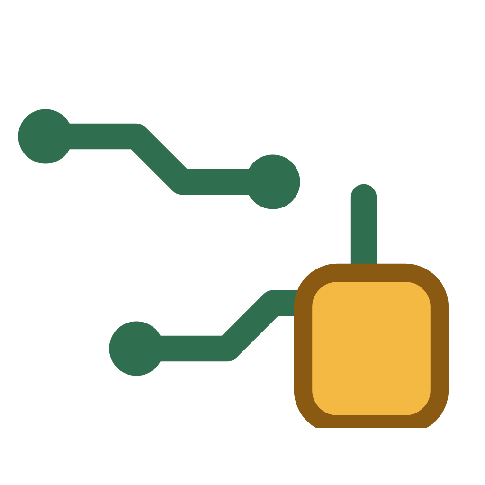
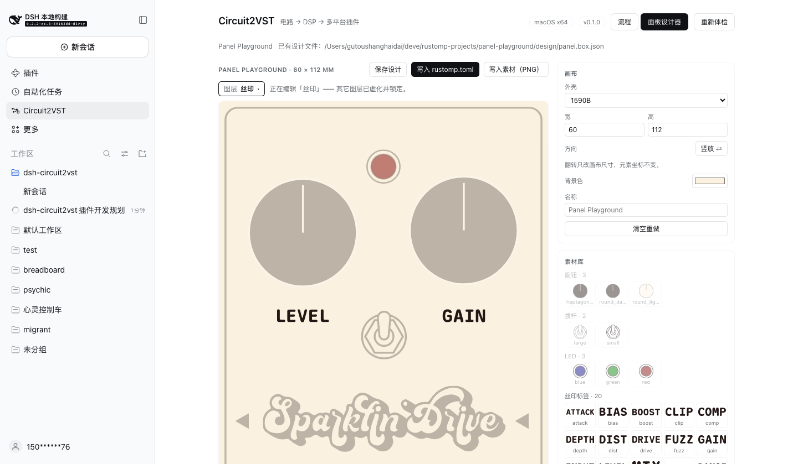
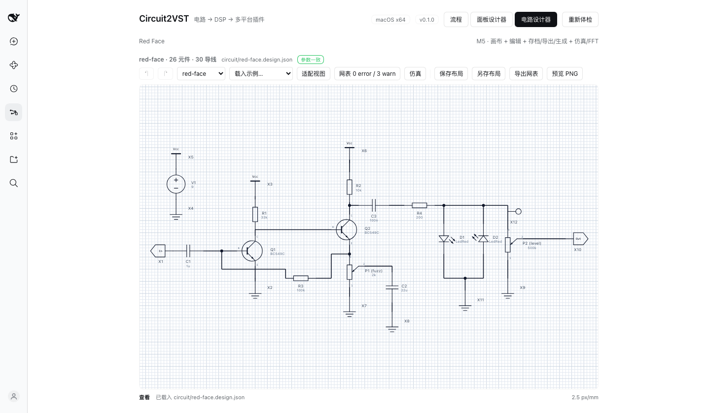
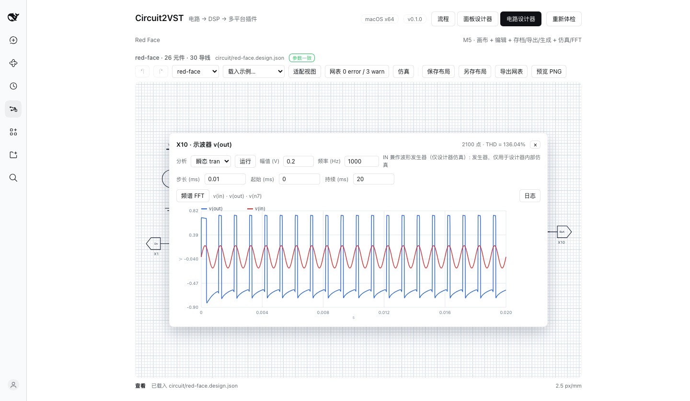

<p align="center">
  
</p>

# dsh-circuit2vst

<p align="left"><b>把自绘电路变成多平台插件（VST3 / AU / CLAP）的 DeepSeek Harness 插件。</b></p>

> 一句话：在 DSH 里画电路、画面板、说一句"打包"，拿到能直接装进 DAW 的安装包。

本仓库是 [rustomp](https://github.com/amonisachicken/rustomp) 生态的**编排层与设计器前端**：
rustomp 负责"电路 → DSP → 插件外壳"，本插件负责"人怎么画、怎么改、怎么生成、怎么打包"。

当前状态（2026-11-16）：

| 层 | 状态 |
|---|---|
| **DSH 插件** | ✅ Host（`circuit2vst` 工具 + HTTP 路由）+ Client（React 设计器），跟随 DSH 深色/浅色主题 |
| **面板设计器** | ✅ 原生 React 移植（无 iframe）：拖放、图层、属性、撤销、12 px/mm 素材导出、写入 `rustomp.toml` |
| **电路设计器** | ✅ 网表引擎与上游**逐字节对拍**；画布、布线、模态编辑、示例库、存档/另存、导出网表/PNG |
| **仿真** | ✅ ngspice 瞬态/AC、FFT、THD；**IN 兼作波形发生器**、**OUT / 测试点兼作示波器**（仅设计器内部） |
| **代码生成** | ✅ `import`（`.design.json` → Rust MNA 电路）、`generate`（`rustomp.toml` → 插件外壳，带漂移检查） |
| **构建前对拍** | ✅ 内置规范：网表无 lint + ngspice 不静音，否则 `pack` 拒绝打包 |
| **平台打包** | ✅ macOS（VST3/AU/CLAP + DMG）、Windows（VST3/CLAP + MSI）、Linux（VST3/CLAP + tar.gz） |

---

## 目录

- [这是什么](#这是什么)
- [安装](#安装)
- [快速开始](#快速开始)
- [两个设计器](#两个设计器)
- [构建前对拍（内置规范）](#构建前对拍内置规范)
- [平台与依赖](#平台与依赖)
- [仓库结构](#仓库结构)
- [测试](#测试)
- [与 rustomp 生态的关系](#与-rustomp-生态的关系)
- [许可证](#许可证)

---

## 这是什么

一个 DSH 插件包（`package.json` 的 `dsh.bundle` + `dsh.client`），装进 DSH 后：

- **侧栏多一个 Circuit2VST 面板**：项目清单（参数数、控件数、是否 GUI/有设计）、流程视图；
- **面板设计器**：像 box designer 一样摆旋钮/拨杆/LED/脚踏/丝印，导出 `ui.toml` + 素材 PNG；
- **电路设计器**：画原理图（GB/T 4728 符号、2.5 mm 栅格、mm 坐标），实时看网表/lint，内置 ngspice 仿真与示波器；
- **给 agent 的工具 `circuit2vst`**：`status / prepare / scaffold / import / generate / enableGui / verify / pack`。
  **所有编译级操作只在这里**——UI 不做文件管理，避免把高级操作暴露给普通用户。

设计原则：*设计器负责"表达需求"，工具负责"执行构建"*。UI 里看不到 `cargo`、`artifacts/` 之类的概念。

## 安装

前置：**DeepSeek Harness**（Web GUI 或桌面版）+ Node ≥ 20（仅测试/构建需要）。

```bash
git clone https://github.com/amonisachicken/dsh-circuit2vst.git
cd dsh-circuit2vst
./install.sh                 # 装进默认的 web profile（link 到本仓库）
```

`install.sh` 会把这个仓库写进 `$DSH_HOME/profiles/<profile>/package.json` 的依赖和
`dsh.profile.bundles`，然后跑 `pnpm install`。可选参数：

| 参数 | 说明 |
|---|---|
| `--profile <name>` | 指定 profile（默认 `web`，例如 `dsh-tui`） |
| `--copy` | 把仓库复制到 `$DSH_HOME/plugins/dsh-circuit2vst` 再链接（适合装完就挪走源码） |
| `--dry-run` | 只打印计划，不改文件 |

装完重启 DSH（或刷新页面），侧栏出现 **Circuit2VST**。开发时保持 `link` 模式即可：
改完源码跑 `npm run build:client`，刷新页面就加载新客户端包。

## 快速开始

在聊天里让 agent 依次调用（或直接说需求）：

```text
circuit2vst status                          # 看平台、依赖、项目清单
circuit2vst prepare                         # 克隆钉死版本的 rustomp 框架与平台 packer
circuit2vst scaffold "My Fuzz" --vendor "HONEYPIE EFFECTS"
#   在 Circuit2VST 面板里打开「电路设计器」画图、打开「面板设计器」摆控件
circuit2vst import my-fuzz circuit/my-fuzz.design.json
circuit2vst enableGui my-fuzz               # 接上自绘面板（幂等，一次即可）
circuit2vst verify my-fuzz                  # ngspice 对拍：静音就拒绝
circuit2vst pack my-fuzz                    # 产出安装包（ARTIFACT: …）
```

`pack` 会用当前平台的 packer：macOS 出 VST3/AU/CLAP + DMG，Windows 出 VST3/CLAP + MSI，Linux 出 VST3/CLAP + tar.gz。

## 两个设计器

### 面板设计器



- 画布 mm 坐标、12 px/mm 素材导出；拖放、多选、对齐、图层、撤销/重做、预览；
- 控件绑定校验：旋钮只能绑 `float` 参数、拨杆绑 `bool`、LED 可绑参数或 `clip_indicator`；
- 「写入 rustomp.toml」把 `[ui]`/`[assets]` 合并进工程清单（带标记的幂等合并）；
- 深色/浅色主题跟随 DSH（纸面保持纸白，墨线不反转）。

### 电路设计器



- 符号库/示例库（低通、二极管削波、共射、同相放大…）、2.5 mm 栅格吸附；
- 元件属性：参考编号、别名、**型号闭集下拉**（二极管/三极管/JFET/MOSFET/运放/LED，与 rustomp 器件闭集一致）、数值+单位、旋转；
- 实时网表卡片：lint（悬空、未知型号、端口、地）与**隐式连接审计**（见下）；
- 仿真：瞬态/AC、FFT 频谱、THD；**IN 兼作波形发生器**（幅值/频率写回 IN 元件），**双击 OUT / 测试点打开示波器**；
- 存档/另存、导出网表（`circuit/netlist/`）、导出 PNG。

#### 仿真与示波器



## 构建前对拍（内置规范）

`pack` 之前自动跑一次与 Rust 引擎**独立**的 ngspice 检查：

1. 取 `circuit/` 下最新的 `.design.json`，重新生成 SPICE；
2. 网表 lint 必须为空；
3. 加 `VIN IN 0 SIN(0 0.1 440)`，`.tran 2u 30m`，取后半段；
4. 断言：输入峰值 ≥ 0.05 V、输出 RMS ≥ 5 mV、VCC（若有）≥ 1 V；
5. **隐式连接**：引脚落在导线中间会被引擎视为连接（上游 UI 不画黑点）。同一引脚穿过多根导线 → `error` 并拒绝打包。

为什么需要：Rust 引擎和 ngspice 是对同一张图的两种实现；短路/错接在两边都"编译通过、运行静音"，只有对拍能抓到。
`Red Face` 就踩过一次：一根横线正好穿过地引脚，ngspice 输出 RMS 1e-5 V，插件静音。

ngspice 缺失时（例如 Windows 打包机）该步骤标记为 `skipped`；**发布前必须在有 ngspice 的机器上跑过 `verify`**。

## 平台与依赖

| 依赖 | 版本/说明 |
|---|---|
| DeepSeek Harness | 任意支持插件 bundle 的版本 |
| Node.js | ≥ 20（测试与 `build:client`） |
| rustomp 框架 | `v0.1.3`（`prepare` 自动克隆） |
| 平台 packer | macOS `v0.1.8` / Windows `v0.3.0` / Linux `v0.1.0`（`prepare` 自动克隆） |
| Rust | 打包平台需要对应工具链（macOS：Xcode CLT；Windows：MSVC BuildTools；Linux：gcc + cmake） |
| ngspice | 可选，但构建前对拍需要（macOS `brew install ngspice`，Windows/Linux 装官方包） |

## 仓库结构

```text
dsh-circuit2vst/
├── index.js                 # Host 入口：apply(ctx, config) + inject
├── cordis.patch.yml         # bundle patch（- insert:）
├── client.js                # 构建产物（scripts/build-client.mjs 拼装，入库）
├── src/
│   ├── host/                # status/prepare/scaffold/import/generate/enableGui/verify/pack
│   │   ├── tool.js          # circuit2vst 工具（编译级操作的唯一入口）
│   │   ├── routes.js        # 面板/设计器的 HTTP 路由
│   │   ├── framework.js     # rustomp 框架 vendor 化与 scaffold
│   │   ├── pack.js          # 契约 B：pack.sh + ARTIFACT 解析
│   │   ├── verify.js        # 构建前 ngspice 对拍
│   │   ├── gui.js           # 启用自绘界面（清单/依赖/editor.rs/模块钩子）
│   │   ├── sim.js           # ngspice 批处理 + THD
│   │   └── params.js        # 参数一致性校验
│   └── client/              # React 设计器（无 iframe）
│       ├── main.js          # 面板：流程视图 / 项目清单 / 设计器切换
│       ├── panel-designer.js
│       ├── circuit-canvas.js
│       ├── circuit-netlist.js   # 网表引擎（与上游逐字节对拍）
│       └── circuit-scope.js     # 仿真/示波器/FFT
├── vendor/
│   ├── circuit/             # 符号、示例、models.lib（来源见 PROVENANCE.md）
│   └── boxdesigner/         # 面板模型/导出器（来源见 PROVENANCE.md）
├── docs/DETAIL.md           # 完整设计说明（能力、契约、决策、故障排查）
└── test/                    # node --test：单元 + 网表对拍 + 参数 + 界面接线 + ngspice 对拍
```

## 测试

```bash
npm test              # 31 个用例（node --test）
npm run build:client  # 重新拼装 client.js
```

- `test/netlist-parity.mjs`：11 个示例的网表与上游**逐字节**一致（goldens 由上游后端产出）；
- `test/params.mjs`：参数一致性校验；
- `test/gui.mjs`：`enableGui` 幂等性与"不覆盖手写 editor"；
- `test/verify.mjs`：ngspice 对拍（环境无 ngspice 时自动 `skip`）；
- `test/units.mjs`：打包参数、ARTIFACT 解析、清单合并、隐式连接审计。

CI：`.github/workflows/ci.yml` 跑两层（无 ngspice 的快速层、装 ngspice 的对拍层），并检查 `client.js` 与源码一致。

## 与 rustomp 生态的关系

```text
rustomp（框架：契约 A/B、DSP、代码生成）
   ├── rustomp-circuit-designer（原理图设计器，符号/网表约定）
   ├── rustomp-box-designer（面板设计器，12 px/mm 素材约定）
   ├── rustomp-mac-plugin / rustomp-win-plugin / rustomp-linux-plugin（packer）
   └── **dsh-circuit2vst（本仓库：DSH 内的编排层 + 原生设计器）**
```

- 契约 A：`rustomp.toml` → 插件外壳；契约 B：`pack.sh` 打印 `ARTIFACT:`；
- 本仓库 `vendor/` 下的符号、示例、`models.lib` 与面板资产来自上游设计器仓库（GPL-3，见各自 `PROVENANCE.md`）；
- 平台打包器与本插件钉在同一组版本上，`prepare` 会拉取它们。

## 许可证

[GPL-3.0-or-later](LICENSE)。`vendor/` 下的符号/素材沿用上游 GPL-3 许可。
