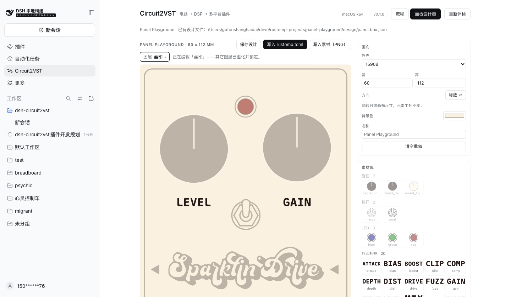
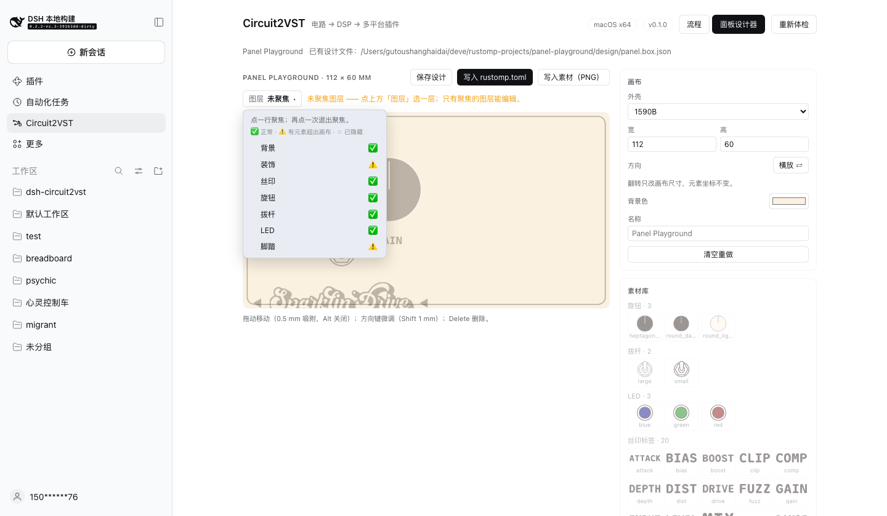
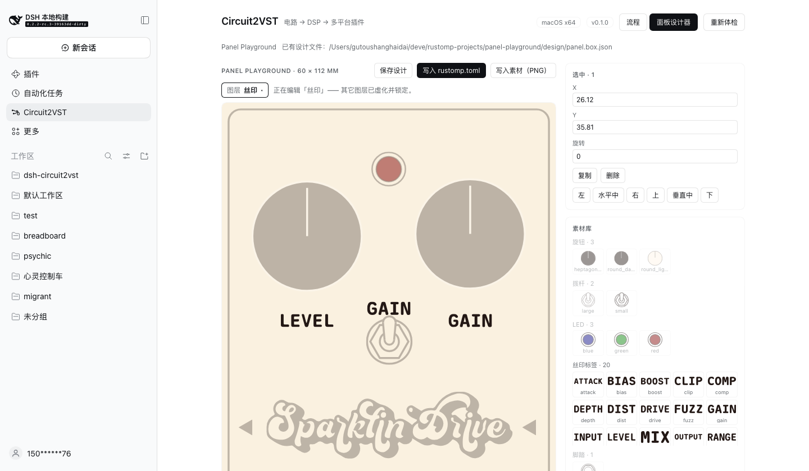

# Circuit2VST

把「手绘电路」变成 VST3 / AU / CLAP 插件的编排层。它不重新实现 DSP，也不重新发明打包：DSP 来自
[`rustomp`](https://github.com/amonisachicken/rustomp)，平台打包来自三个实现契约 B 的 `pack.sh`，
本插件负责把这两头接到 DSH 里，并把每一步的状态说清楚。

## 现在能做什么

| 能力 | 行为 |
| --- | --- |
| **环境体检** | 逐项检查 git / python3 ≥ 3.11 / Rust cargo / rustup 与 universal 两个 target / `cargo nih-plug` / cmake / Xcode CLT / ngspice / docker（Windows 另查 bash 与 MSVC），每项给出"缺什么、怎么装" |
| **按平台拉依赖** | 只拉当前平台需要的东西：`rustomp` 框架 + 本平台打包器（macOS `rustomp-mac-plugin`、Windows `rustomp-win-plugin`、Linux `rustomp-linux-plugin`），版本按固定 tag 钉住 |
| **新建项目** | 调框架自己的 `new-plugin.sh`（`RUSTOMP_GUEST` 指路），项目建在项目目录下、框架树之外，并当场生成插件侧代码 |
| **项目清单与快捷入口** | 列出每个项目的名字、参数数、面板控件数、是否有 GUI / 设计文件；**选中的项目行首有 ● 焦点标记**（槽位固定，切换时不抖动）并高亮整行；**焦点会记住**（浏览器 localStorage 的 `circuit2vst.selectedProject`），重开面板回到上次选中的项目；若那个项目已被删除，才回退到"第一个有设计/有界面的项目"；**每行右侧两个入口**：「面板设计器」「电路设计器」直接切到对应设计器并选中该项目 |
| **导入电路** | 由 `circuit2vst` 工具的 `import` 动作触发：调 `rustomp-import --mna`，把 `.design.json`（自动带 vendor 的 `symbols.json`）或 `.cir` 写成 `circuit/src/generated/circuit.rs`，随后用 `--check` 复核没有漂移 |
| **生成代码** | 调 `rustomp-gen` 重写身份/参数/Plugin/面板代码，随后 `--check` 防漂移 |
| **打包** | 调本平台 `pack.sh`（契约 B），解析 stdout 的 `ARTIFACT:` 行，把路径与日志回显到面板 |
| **合并面板产物** | 把设计器导出的 `ui.toml`（`[assets]` + `[ui]`）替换进 `rustomp.toml` 的对应区段，其余段落不动 |
| **网络代理** | 面板里可填代理地址，只注入给 `git clone` / 打包器的下载脚本；也可沿用 Harness 进程的 `HTTPS_PROXY` |
| **长任务** | 新建/导入/生成/打包都跑成后台任务，HTTP 请求不等编译；面板轮询状态并显示日志、产物与最近任务 |
| **参数一致性校验** | 每次 `import` / `generate` 之后自动对比 `rustomp.toml` 与生成的电路代码：`circuit = "x"` 映射的字段在电路里是否存在（或用 `params_builder` 位置传参）、电路里有没有没被界面暴露的参数、`[[ui.*]]` 有没有绑到不存在的参数（`clip_indicator` 这类设计器的虚拟指示除外）、网表电路有没有 IN/OUT 端口。结果追加到任务日志；画布标题行显示 `参数一致 / 参数问题 N`，展开「网表」可看明细 |
| **给 agent 的工具** | `circuit2vst` 工具：`status` / `prepare` / `scaffold` / `import` / `generate` / `enableGui` / `pack` |
| **构建前对拍** | `circuit2vst verify`：拿项目最新的 `.design.json` 重新生成网表，检查无 lint，再用 ngspice 跑 0.1 V / 440 Hz 正弦瞬态，**输出 RMS < 5 mV 判为静音并拒绝**。`pack` 会自动先跑这道闸门（ngspice 缺失时记 `skipped` 并继续，Windows 打包机就是这种情况） |
| **启用界面** | `circuit2vst enableGui`：把脚手架工程接上自绘面板（幂等）。改 `[build] gui = true`、把 `rustomp-gui` 加进工作区依赖、给 plugin 加 `nih_plug_egui` + `rustomp-gui` 且 `default = ["gui"]`、按模板写 `plugin/src/editor.rs`（已存在则不覆盖）、给 `lib.rs` 挂 `#[cfg(feature = "gui")] mod editor;`；缺 `[ui]` 面板段时只警告不阻断 |

面板在左侧栏有独立图标，点开占据中央区域，顶部切换 **流程 / 面板设计器**。

流程页自上而下：**项目**（新建 + 列表 + 行内设计器入口）→ 阻塞（有问题时）→ 环境体检 → 生态依赖 → 网络 → 提示。

> **导入网表 / 生成代码 / 打包 / 安装到本机不在界面上**（流程页和两个设计器都没有入口）：它们是文件与编译级操作，
> 按本项目的原则只在聊天里由对话或 `circuit2vst` 工具完成。面板与设计器只负责"看清单、画、存"。

## 怎么用

1. 打开 **Circuit2VST** 面板，先看「环境体检」。
2. 点 **准备依赖**：只 clone 当前平台需要的两个仓，落在项目目录下的 `.deps/`。
3. macOS 首次打包前，再点 **拉取第三方源码**。
4. 在「项目」里填名字 → **创建**；之后导入网表 / 生成代码 / 打包都在聊天里说（或由 agent 调 `circuit2vst`）。
5. 访问 GitHub 需要代理时，在「网络」里填地址后点 **保存**，再重试上一步。

默认位置（可在 `cordis.patch.yml` 的 `config` 里改）：

```text
~/deve/rustomp-projects/                                 项目目录
~/deve/rustomp-projects/.circuit2vst.json                本机设置（目前只有 proxy）
~/deve/rustomp-projects/.deps/rustomp/                   框架（v0.1.2）
~/deve/rustomp-projects/.deps/rustomp-mac-plugin/        本平台打包器（v0.1.7）
```

## 配置

`cordis.patch.yml` 里这一行的 `config` 支持：

| 键 | 默认 | 作用 |
| --- | --- | --- |
| `projectsDir` | `~/deve/rustomp-projects` | 项目目录 |
| `depsDir` | `<projectsDir>/.deps` | 框架与打包器的 checkout 目录 |
| `allowNetwork` | `true` | 关掉后不自动 clone |
| `fetchThirdParty` | `false` | 预留：准备依赖时一并拉 macOS 第三方源码 |
| `proxy` | 空 | 钉死整个 profile 的代理；留空则读 `.circuit2vst.json` 或环境变量 |
| `packerOverride` | 空 | 用一个**自定义的契约 B `pack.sh`** 替换平台默认打包器（新平台 / 容器包装 / 私有打包器） |
| `packerFormats` | 六种全开 | `packerOverride` 时声明它支持哪些 `--format` |
| `packerLabel` | `自定义打包器` | 面板上给这个自定义打包器起的名字 |

## 版本配套

钉住的组合与 rustomp 文档一致：框架 `v0.1.2` + macOS `v0.1.7` + Windows `v0.3.0` + Linux `v0.1.0`。
`prepare` 之后会核对 checkout 的 tag 与钉住值，不一致会在面板与工具输出里标出来。

## 面板设计器

面板顶部有两个模式：**流程** 与 **面板设计器**。设计器是
[`rustomp-box-designer`](https://github.com/amonisachicken/rustomp-box-designer) 的 React 重写：
模型、几何与导出用上游**原样拷贝**的纯函数（`vendor/boxdesigner/`，见其 `PROVENANCE.md`），
所以导出结果与上游 CLI 逐字节一致，界面则换成 DSH 的主题 tokens 与布局。



图层下拉与状态徽标（横放后 `装饰`/`脚踏` 有元素越界，徽标变 ⚠️）：




右栏首块是同一个检查器位置：点元素就变「选中」，其余时候只留一行提示（聚焦「背景」后点画布才变「画布」）：



| 能力 | 行为 |
| --- | --- |
| 画布 | 直接渲染 `panelSvg(doc, assets, { controls: true, dimLayers })` —— 与导出用的是同一个函数，画布与产物不会跑偏 |
| **图层聚焦（严格）** | 画布上方一个**收起式下拉**（`图层 · 未聚焦 ▾`）切换焦点，一次只聚焦一层：菜单里点一行聚焦，再点同一行退出；点外面或 `Esc` 收起。**未聚焦时全部虚化且不可编辑**；只有聚焦层的元素能选中/拖动/改属性，其它层按上游同款 `dimLayers` 降到 28% 不透明度；新增元素会把焦点切到它所在的层 |
| **预览 / 编辑** | 图层选择器左侧的分段开关。**预览**：所有图层不虚化也不可编辑，图层下拉禁用，可在画布上模拟交互——拖旋钮改值（竖直 260 px 走完全程，与运行时一致）、点拨杆/LED 切换、按住脚踏看按下反馈；切回**编辑**恢复图层聚焦逻辑 |
| **图层状态徽标** | 每行右侧的 ✅ 同时是显隐开关与状态灯：该层有元素超出画布时变 ⚠️（判据与 `validate()` 相同：1 mm 容差、边框豁免），隐藏后变 ◻；点徽标只切显隐、不收起菜单，菜单顶部有一行图例 |
| **检查器（右栏第一块）** | 三态合一、只占一块位置：**选中元素时**显示「选中 · N」属性（素材/参数/几何 + 复制/删除）；**聚焦「背景」层并在画布上点一下**才显示「画布」（外壳/宽高/方向/背景色/名称/清空重做）；其余情况只有一行提示，不占版面 |
| **画布方向** | 在「画布」检查器里：「竖放 ⇄ / 横放 ⇄」一键换向（交换 `canvas_mm` / `outer_mm` / `window_px`），另有宽/高毫米输入与外壳预设 |
| **越界自动回位** | 换向或改小画布后，凡是因此落到画布外的元素会被移到最近的合法位置（比画布还大的元素居中），并提示「N 个元素已移回画布内」；用与拖拽相同的 `move()` 施加，拨杆两态的 y/pivot 一起修正 |
| **背景色** | 在「画布」检查器里取色，改 `[ui].background`，实时预览 |
| **素材库** | 内置素材按类分组直接点选添加：旋钮 3 / 拨杆 2 组 / LED 3 / **丝印标签 20** / 脚踏 1；缩略图就是素材 SVG 本身，当前聚焦层之外的分组会变暗 |
| 选中 / 拖动 | 点击选中（Shift 加选），画布上拖动按 0.5 mm 吸附（按住 Alt 关闭吸附） |
| 键盘 | 方向键 0.1 mm，Shift+方向键 1 mm，Delete 删除，⌘/Ctrl+D 复制 |
| 添加 | 旋钮 / 拨杆 / LED / 脚踏 / 边框 / 矩形（拨杆按素材的六边形中心自动对齐两态） |
| 属性 | 按类型给字段：素材、参数（只列出可绑类型）、圆心、旋转、内缩/圆角/线宽、灯色…… |
| 对齐 | 左/水平中/右/上/垂直中/下；三个以上还有等间距 |
| 图层 | 7 层显隐（背景/装饰/丝印/旋钮/拨杆/LED/脚踏） |
| 校验 | 导出前跑上游 `validate()`：参数缺失、类型错配、素材缺失、两态未对齐、超出画布 |
| 打开 / 保存 | 读写 `<项目>/design/panel.box.json` |
| 写入 rustomp.toml | 用上游 `uiToml()` 生成标记块，只替换设计器拥有的区段（`[requires]` 等其它段原样保留） |
| 写入素材（PNG） | 浏览器 canvas 按 **12 px/mm** 栅格化 `panel.png` 与各控件贴图，写到 `<项目>/assets/` |

### 与上游的一致性（可复跑）

```bash
npm run test:parity     # ui.toml / panel.svg 与上游 CLI 逐字节比对
```

实测（Sparklin Drive 的真实 `panel.box.json`）：`ui.toml` 1298 字节、`panel.svg` 37913 字节，
与 `node <上游>/scripts/export.mjs ... --svg-only` 的输出完全相同。
把上游 checkout 放在 `BOX_DESIGNER_DIR`（或 `/tmp/rustomp-box-designer`）时会启用**活体**比对，
否则只比对提交在 `test/fixtures/` 的夹具。

## 电路设计器（M4，进行中）

上游的电路设计器正在移植，**M4.0 地基已完成**：

| 内容 | 位置 / 命令 |
| --- | --- |
| 符号资产与示例（18 个符号 SVG、`symbols.json`、4 个示例工程） | `vendor/circuit/`（钉 `f4eaa45`，GPL-3，见其 `PROVENANCE.md`） |
| 网表生成器（由上游 `backend/src/netlist.rs` 逐函数移植，纯函数、无 IO） | `src/client/circuit-netlist.js` |
| 逐字节对拍（4 个官方示例 + 7 个合成用例，含电位器/镜像旋转/网络标签/各类 lint） | `npm run test:netlist` |
| 重新生成黄金网表（需要本机跑着上游后端 `:3600`） | `npm run goldens:netlist` |

黄金网表**由上游后端生成**（不是由移植体自证），并保留活体比对：本机跑着后端时，
测试会额外把同一份 `.design.json` 交给后端再比一次。

**M4.1 画布已可用**（第三个页签「电路设计器」）：

| 能力 | 行为 |
| --- | --- |
| 画布 | 2.5 mm 栅格（每 4 格加粗）、矢量符号、位号与数值、符号内文字**永远正立** |
| 连接 | T 型接点画黑点、悬空引脚画红虚线圈（来自实时网表，不是前端猜的） |
| 视图 | 滚轮缩放（2–60 px/mm，以光标为锚）、拖动平移、适配视图 |
| 命中 | 5 mm 容差、导线优先（距离差 < 1 mm 时选线），hover 高亮 |
| 属性 | 参考编号、别名、**型号下拉**（二极管 / 三极管 / JFET / MOSFET / 运放 / LED 的闭集，数据来自 `symbols.json`，与 rustomp 的器件闭集一致）、数值 + 单位、旋转（0/90/180/270）；位置只读 |
| 网表 | 每次改动即时重算，可展开看 `.cir` 与 lint；与 M4.0 是同一个引擎、同一份黄金网表 |

**M4.2 模态编辑已可用**（照上游键表）：

| 键 | 行为 |
| --- | --- |
| `esc` | 回查看模式；手里拿着元件时先**放回原位** |
| `r` / `c` / `g` | 放置电阻 / 电容 / 接地，点击落点后**连续放置**，`ctrl+r` 旋转、`ctrl+e` 镜像 |
| `w` | 画导线：点起点 → 只走上下左右 → 再点定点，继续连点；落笔后自动**归一化**（共线接续合并、D-023 的 T 型接点不被吞掉）|
| `q` | 删除：点元件删元件，点导线只删该段 |
| `m` | 移动：点元件拿起、点画布放下、`esc` 放回 |
| `d` | 复制：点一个元件，数值/型号/别名一起带过去（D-022）|
| `空格` | 元件库（18 个符号的网格，点一个进放置模式）|
| `⌘/Ctrl+Z` `⌘/Ctrl+Y` | 撤销 / 重做（快照栈，上限 200 步）|
| `h` | 快捷键面板 |

外加 D-021 的剪线：元件的**共线引脚**之间若有一根完整导线，放置/移动时自动剪掉那一段。
状态栏实时显示模式、最近一步结果与光标 mm 坐标。

**M4.3 存档与导出已可用**：

| 动作 | 产物 |
| --- | --- |
| 打开「电路设计器」 | 读 `<项目>/circuit/*.design.json`（取最新的那份）；没有就载入示例并提示未保存 |
| **保存布局** | 写回当前文件（`circuit/<名称>.design.json`）；**若当前是示例模板，第一次会转为「另存布局」** |
| **另存布局** | 弹出小窗输入新文件名，写到 `circuit/<新名称>.design.json`，并把它设为当前文档名 |
| **载入布局** | 下拉列出本工程 `circuit/*.design.json`，切换前**自动保存当前布局**；示例模板不自动落盘（避免覆盖同名文件），状态栏会提示 |
| **载入示例** | 打开内置示例；**先把当前正在编辑的布局自动保存**，示例按「模板」对待（标题行标 `模板`，有改动标 `已修改`）|
| **导出网表** | 写 `circuit/netlist/<名称>.cir`（与画布用的引擎同一份输出） |
| **预览 PNG** | 把当前视野光栅化成 2× PNG（去栅格与悬空标记），写 `circuit/<名称>.png` |
| ~~生成代码~~ | **不在画布上**：需要时在聊天里调 `circuit2vst import` → `circuit2vst generate`；画布只负责画与存 |

至此 M4（电路设计器）完成：画布、模态编辑、存档、导出都在设计器里；生成代码与打包走聊天/工具。

## 仿真与示波器（M5）

**仿真**按钮打开对话框：分析类型（瞬态 `tran` / 频响 `ac`）、步长/起始/持续或 points/f start/f stop，
运行后画出 `v(in)`、`v(out)` 与测试点的波形，右上角给出点数与 **THD**；「频谱 FFT」切到对数频率轴 + dB；
「日志」可看本次拼给 ngspice 的完整网表。

| 层 | 做什么 |
| --- | --- |
| 浏览器 | 网表仍由 M4 的同一引擎生成；FFT 与绘图在前端（`circuitFftSpectrum` / `circuitPlot`）|
| Host | 把交付网表变成可仿真批次：补 `VCC/VEE` 电源、在 `in` 网挂 `VSIM`（tran 用 `SIN`、ac 用 `AC 1`）、内联 `models.lib`、`.save`/`.print` 探针、分析行；跑 `ngspice -b -r`，解析 ASCII rawfile；THD 用上游同款"末 8 周期 + Hann 最小二乘"公式 |

瞬态的时间输入用 **ms**（步长 / 起始 / 持续），发送前换算成秒；频响与 FFT 的横轴都用**对数频率**。

**与上游逐点对拍**（lowpass 示例，0.2 V / 1 kHz / 20 ms）：两边都是 **2010 点**，
`v(out)` 峰值 **0.0509 V**、稳态 **0.0314 V**、**THD 0.00000**，探针集合也相同。


### Windows 验证（2026-11-16，真机）

目标机：`DESKTOP-6LCPLIH`（Windows 10.0.19044 / x64，经 `castlew` 跳板 SSH），
工具链 git 2.52、MSYS2 bash 5.3.9、Python 3.12、cargo 1.99、MSVC BuildTools 2022、cargo-nih-plug，
GitHub 走该机 `vpn.env` 里的 `http://server.local:8888`。

用插件自己的 Host 代码（`src/host/*`，经 DSH 自带 node 运行）依次执行：

| 步骤 | 结果 |
| --- | --- |
| `status` | 9 项体检通过、`可生成 / 可打包` |
| `prepare` | 框架 v0.1.2（913222a）、Windows 打包器 v0.3.0（246ad49）按钉住的 tag 克隆 |
| `scaffold` | `new-plugin.sh` 在 MSYS2 bash 下建出 `win-test`，`rustomp-gen` 写 5 个文件 |
| `import` | `.design.json` → `circuit.rs`（3 个未知量），漂移检查通过 |
| `generate` | 漂移检查通过 |
| `pack` | **VST3 + CLAP，mono / stereo 共 4 个产物**，打包器自检 `PE 架构校验通过（x64）` |

产物：`win-test/target/bundled/Win Test {Mono,Stereo}.{vst3,clap}`（CLAP 为 PE x64，886 KB）。
打包器提示两条被跳过的宿主侧验证（缺 pluginval、缺 CLAP SDK 头文件），不影响产物生成。

**这次验证改出的三个真问题：**

1. `doctor` 的 MSVC 行被硬编码成 `warn`，而就绪判定只认 `ok` —— Windows 上 `canGenerate/canPack` 永远为 false。
   改为用 `vswhere` 真探测 VC 工具链。
2. `symbols.json` 的默认值只写在路由和工具里，`service.importCircuit` 没有：从其他入口（含测试驱动）
   导入 `.design.json` 会报"读不到 symbols.json"。默认值下沉到 `framework.importCircuit`。
3. 框架 v0.1.2 的 `new-plugin.sh` 用 `os.path.relpath` 拼路径，Windows 下把 `..\.deps\rustomp`
   写进 `Cargo.toml`（`\r` 是非法转义），cargo 连清单都读不了。插件侧改为给 bash 脚本传 POSIX 路径
   （`scriptPath`），并在建项目后规范化 TOML 里的 `path = "…"`。这个应在框架侧修，已记录。


## 构建前对拍（内置规范）

打包前必须通过一次**独立于 Rust 引擎**的 ngspice 校验，否则 `pack` 直接拒绝：

1. 取 `circuit/` 下最新的 `.design.json`，用网表引擎重新生成 SPICE；
2. 网表 lint 必须为空（悬空、未知型号等直接失败）；
3. 加 `VIN IN 0 SIN(0 0.1 440)`，`.tran 2u 30m`，取后半段数据；
4. 断言：输入峰值 ≥ 0.05 V、输出 RMS ≥ 5 mV、VCC（若有）≥ 1 V。

**为什么需要**：Rust 引擎和 ngspice 是对同一张图的两种实现。短路/错接这类问题在两边都"编译通过、运行静音"，
只有对拍能抓到——Red Face 就踩过：基极那根横线正好穿过 X2 的地引脚，ngspice 输出 RMS 1e-5 V。

Red Face 实测：

| 走线 | 输入峰值 | 输出 RMS |
|---|---|---|
| 基极线穿过 X2 地引脚（错） | 0.100 V | 0.00001 V |
| 改到 y=20 后（对） | 0.100 V | 0.638 V |

ngspice 缺失时（例如 Windows 打包机）该步骤标记为 `skipped`，不算通过；发布前应在有 ngspice 的机器上跑过 `circuit2vst verify`。

## 隐式连接审计（为什么"没黑点也会连上"）

上游设计器只给两种情况画黑点（`wireJunctions`）：**导线端点落在另一根导线中间**、**三条以上导线端点重合**。
引脚落在导线中间**不画点**，但网表引擎（上游后端与我们的移植一致）把"引脚在导线上"视为连接——
于是就出现"界面上没有黑点、实际却连上了"的隐式连接。Red Face 的静音就是它：基极线横穿 X2 的地引脚。

插件侧的处理（**不改**移植引擎，保持与上游逐字节一致）：

1. `auditImplicitConnections(doc, table)` 单独审计所有"引脚落在导线中间"的隐式连接；
2. **同一个引脚位于两根及以上的导线中间** → `error`（它是把两根导线短接的桥），典型就是交叉线；
   只有一根导线中间（如地符号的短出头）→ `warn`，提醒但不拦；
3. 电路设计器的网表卡片、徽标会显示这些条目；`circuit2vst verify` 也会列出；
4. `pack` 前对拍把它们计入闸门：出现 `error` 直接拒绝打包。

Red Face 修好前后：坏走线 = `X2.GND 位于导线 w25 / w51 的中间 → error`；改线后只剩三条短出头的 `warn`。

## 深色模式

两个设计器与面板的界面元素（按钮、浮层、输入框、徽标）统一用 `--dsw-alias-*` 令牌，不写死颜色。
两条容易踩的规则：

1. **品牌色按钮上的文字用 `--dsw-alias-bg-base`**，不要写 `#fff`：浅色主题的品牌色是近黑（白字），
   深色主题的品牌色是近白（此时需要深字）。写死白色会出现"白底白字"。
2. **纸面永远是纸白**：电路画布、面板预览、元件库缩略图、示波器图都是墨线画在纸上，
   不随主题反转；缩略图因此有自己的浅色底（`#fbfaf7` / `#f7f5f0`），否则深色卡片上的深色墨线会消失。


## macOS 从源码装 ngspice（本机验证过的配方）

没有 brew/macports 包，或想钉版本时：

```bash
curl -LO https://downloads.sourceforge.net/project/ngspice/ng-spice-rework/47/ngspice-47.tar.gz
tar xzf ngspice-47.tar.gz && cd ngspice-47
./configure --prefix=/usr/local --without-x --disable-debug --disable-openmp --without-readline
make -j"$(sysctl -n hw.ncpu)" && make install
```

两个**必须**关掉的开关（否则编不过）：

| 开关 | 不关会怎样 |
| --- | --- |
| `--disable-openmp` | `misc_time.c:53: fatal error: 'omp.h' file not found` —— Apple clang 不自带 OpenMP 头 |
| `--without-readline` | `signal_handler.c:66: error: implicit declaration of function 'rl_reset_after_signal'` —— macOS 是 libedit 的 readline 仿真，缺 GNU readline ≥ 8 的符号 |

代价只有两点：交互式 shell 没有行编辑、求解器单线程。`-b` 批处理、ASCII rawfile、`.include` 都正常，
而设计器仿真与 rustomp 对拍只走批处理。装完自检：

```bash
ngspice -b tools/oracle/smoke/clipper_1n4148.cir   # THD 应为 0.353802 %
cd .. && ./scripts/verify.sh --only oracle          # 四层对拍
```

## 限制

- **电路设计器还在移植中**：目前只有网表引擎（M4.0）；画布与编辑在 M4.1/M4.2。
- 上游网表引擎的两个怪癖（已在移植体里如实复刻，测试里注明）：① 它只读导线的**前两个点**，
  多点折线会被静默截断（前端本来就把每一笔拆成两点线段）；② 同一根网络上挂两个不同的显式网络名时，
  名字取决于 Rust `HashMap` 的迭代顺序 —— 这是上游的非确定性，对拍用例刻意不覆盖。
- **设计器的缺口**：没有撤销/重做、没有外部 SVG 导入按钮（既有设计里的 `imported` 素材能正常显示与导出）、
  不导出 `panel.svg`、不做框选；浏览器栅格化的 PNG 与 Inkscape 出的**像素尺寸相同、字节不同**。
- **换向不会重排元素**：横/竖切换只改画布尺寸，元素坐标保持不变；越界的元素会在「校验」里以次要色提示
  （`超出画布` 属于布局警告，不挡导出，运行时会按画布裁切）。
- **平台验证程度不同**：macOS 真机验证（AU/VST3/CLAP 真产物）；Linux 走打包器自带的 `debian:12` 容器路径（`packerOverride`）；Windows 的分派与脚本调用已实现，但没有真机结果。
- **体检标签是中文**：检查项名字与建议文案由 Host 生成，目前只有中文；面板自身文案中英双语。
- 依赖是 `git clone` 下来的独立 checkout，不是本插件打包进来的源码；上游升级请重跑准备或手动切 tag。
- 打包日志是任务结束后一次性回显，不是逐行流式。
- 用 `packerOverride` 打包时产物写在 `<项目>/target-custom/`，与宿主平台的 `target/` 隔开：
  同名 `.clap` 在 macOS 是目录、在 Linux 是文件，共用会撞 "Is a directory (os error 21)"。
- 单元测试只覆盖纯逻辑（`npm test` → `node --test test/units.mjs`），不覆盖真实构建。
